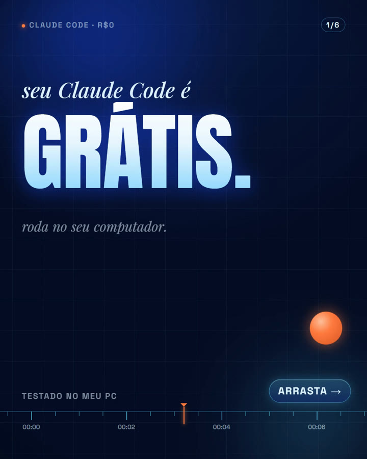

# Skill grátis: Carrossel vivo com o Claude

Skill para o **Claude** (Claude Code / app no computador) criar **carrosséis do Instagram em que todo slide se mexe**:
cada slide é um vídeo curto em loop (1080x1350, 4:5, 30 fps), com motion design feito por código, **música e efeitos
sonoros também gerados por código** e tudo caindo na batida de 120 BPM. A música continua de um slide para o outro,
então arrastar parece uma música só. Custo: **R$0**. Nada de modelo de vídeo, nada de crédito.

Mostrada no vídeo do canal [@celticmatheus1](https://www.youtube.com/@celticmatheus1).

## Dois modos

1. **Motion puro (sem imagem)** — palavras gigantes, uma bola laranja que atravessa o carrossel inteiro e uma régua
   de tempo embaixo. Exemplo completo em `exemplo/claude-code-gratis/` (prévia: `previa_carrossel.mp4`).
2. **Com a sua foto** — a foto é recortada (sem fundo) e montada em camadas: fundo → palavra gigante → você →
   cartões flutuando. Cada camada se mexe sozinha.

## Como instalar
1. Baixe este repositório (botão verde **Code → Download ZIP**) e descompacte.
2. Copie a pasta para a pasta de skills do Claude: `~/.claude/skills/carrossel-vivo/`
   (no Windows: `C:\Users\SEU_USUARIO\.claude\skills\carrossel-vivo\`).
3. Instale o que o render usa: **Node.js** (o `npx hyperframes` baixa sozinho na primeira vez), **FFmpeg** e
   **Python 3** com `pip install numpy scipy`.

## Como usar
Abra o Claude numa pasta de projeto e peça:

> Usa a skill carrossel-vivo. Faz um carrossel sobre "como eu organizo minha semana com IA".

ou, com a sua foto:

> Usa a skill carrossel-vivo com a minha foto (foto.jpg). Tema: o resultado do meu curso.

O Claude mostra o plano dos slides, você aprova, e ele gera a música, confere cada slide e renderiza. No fim sai uma
pasta `postar/` com `parte_01_de_06.mp4`, `parte_02_de_06.mp4`… na ordem certa e a legenda do post. No Instagram:
novo post → seleciona os vídeos em ordem → carrossel.

## O que vem aqui
- `SKILL.md` — as instruções (3 regras: easing, peso, ritmo; ritmo de 4 s por slide; fluxo; bugs conhecidos)
- `kit/` — tema visual (`cv.css`), helpers de animação na batida (`cv.js`), fontes e GSAP
- `tools/musica.py` — música + efeitos por código, cada slide com número inteiro de compassos (loop sem pulo)
- `tools/montar.py` — monta cada slide, tira fotos de conferência, renderiza com HyperFrames e cria `postar/`
- `exemplo/claude-code-gratis/` — carrossel de 6 slides pronto para estudar e copiar

## Créditos
A ideia do "carrossel vivo" e as 3 regras vêm do vídeo do **NextPhase** (Jad M.H), "New VIRAL Carousels With Motion
Graphics 0$ Turned It Into a Skill". Esta skill foi escrita do zero, em português; não contém arquivos da skill dele.
Render com [HyperFrames](https://github.com/heygen-com/hyperframes) e [FFmpeg](https://ffmpeg.org).

## Licença
MIT (veja `LICENSE`). As fontes em `kit/fonts/` (Inter, Anton, Playfair Display, Space Grotesk) têm licença
SIL Open Font License 1.1. O `kit/vendor/gsap.min.js` é o GSAP 3.14.2, distribuído sob a licença padrão gratuita
da GreenSock (https://gsap.com/standard-license).
